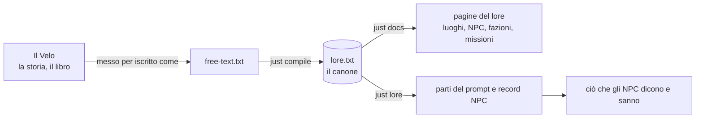
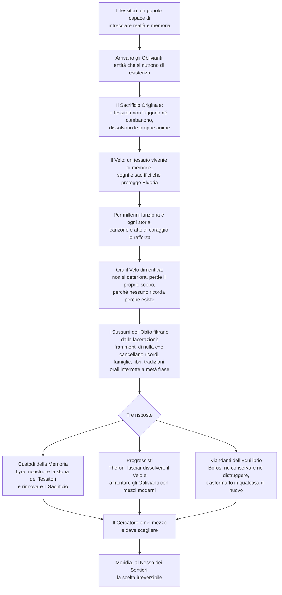

# Il Velo

[Tutti i progetti](../README.md) · [Nexus](README.md) · Motore: [panoramica](ENGINE.md), [flusso delle richieste](ENGINE-REQUEST-FLOW.md), [comandi](ENGINE-COMMANDS.md), [prompt](ENGINE-PROMPT.md), [meccaniche](ENGINE-MECHANICS.md), [storage e configurazione](ENGINE-STORAGE-CONFIG.md) · Pipeline: [panoramica](PIPELINE.md), [digest](PIPELINE-DIGEST.md), [derivazione](PIPELINE-DERIVE.md) · Lore: [il Velo](VEIL.md), [mondo](VEIL-WORLD.md), [luoghi](VEIL-PLACES.md), [NPC](VEIL-NPCS.md), [fazioni](VEIL-FACTIONS.md), [missioni](VEIL-MISSIONS.md)

La storia da cui nasce tutto il resto: lo storyboard *The Weaving Veil* (L'Intreccio delle Memorie), il mondo di **Eldoria**.
Questa pagina è la storia in breve, scritta a partire dal testo dello storyboard. Lo stesso materiale, distillato e strutturato, è il
[lore](VEIL-WORLD.md); dal lore la [pipeline](PIPELINE.md) produce ciò che dicono gli NPC. L'ordine dei livelli:

## Cosa è successo, e cosa sta succedendo

Le tre risposte sono **incompatibili**: ciò che Lyra salva, Theron lo lascia andare; la terza via di Boros è letta da entrambi come
un modo di non scegliere. Nessuna via è gratuita; i costi sono descritti in [fazioni e finale](VEIL-FACTIONS.md).

## I termini

| Termine | Significato nella storia |
|---|---|
| **Il Velo** | Il tessuto vivente in cui si sono trasformati i Tessitori; la protezione di Eldoria e la sua memoria collettiva |
| **I Tessitori** | L'antico popolo che si sacrificò per farlo |
| **Il Sacrificio Originale** | L'atto che creò il Velo; i suoi fili più antichi sono quelli che ora si sfilacciano |
| **Gli Oblivianti** | Le entità cosmiche che si nutrono di esistenza |
| **I Sussurri dell'Oblio** | Ciò che filtra dalle lacerazioni; cancella la memoria, perfino l'idea di esistere |
| **I Nodi Primordiali** | Luoghi dove la memoria del Sacrificio è ancora intatta; la ricerca di Lyra |
| **Il Cercatore** | Il giocatore; mai "Cercastorie" |

Di più nella [pagina del mondo](VEIL-WORLD.md#termini).

## I temi su cui è costruita la storia

- La memoria collettiva contro il diritto all'oblio.
- Il sacrificio tra generazioni, e la gratitudine verso gli antenati.
- Il paradosso della protezione: ciò che ci salva può anche imprigionarci.
- Le storie come identità.
- Tradizione contro progresso.

Le regole di scrittura che ne discendono (conflitti reali, costi irreversibili, conoscenza parziale, niente falsa armonia) stanno in
`lore.txt` [03] e in `CLAUDE.md`, e raggiungono i personaggi attraverso il [prompt](ENGINE-PROMPT.md).

## Dalla storia alle pagine

| Parte della storia | Dove leggerla nel lore |
|---|---|
| Il mondo, la crisi, i termini | [Il mondo](VEIL-WORLD.md) |
| Dove accade | [Luoghi](VEIL-PLACES.md) |
| Chi la vive | [NPC](VEIL-NPCS.md) |
| Le tre risposte e il finale | [Fazioni e finale](VEIL-FACTIONS.md) |
| Cosa deve fare e ottenere il Cercatore | [La catena di missioni](VEIL-MISSIONS.md) |
