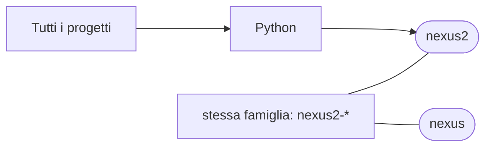

# nexus2

[Tutti i progetti](../README.md)

> Voce di catalogo generata dai metadati di GitHub con `build_projects.py` (`just projects`). Non si modifica a mano.

| | |
|---|---|
| Repository | [pakkio/nexus2](https://github.com/pakkio/nexus2) |
| Linguaggio | Python |
| Tipo | originale |
| Creato | 2026-05-08 |
| Ultimo push | 2026-10-18 |
| Dimensione | 130 KB |

## Dal suo README

> nexus2 AI-powered text RPG engine set in the fantasy world of Eldoria, designed to run NPCs inside a Second Life / OpenSim region. Successor of nexus. Persistent wiki**: flat markdown files the NPCs read and write through LLM tool calling (`wiki.py`, `wiki/`) NPC agents**: LLM-driven personalities defined in `NPCs/*.json` (`generate_conversation.py`, `llm.py`)

## Dove si colloca

Stessa famiglia (prefisso del nome in comune): [nexus](../nexus/README.md)
