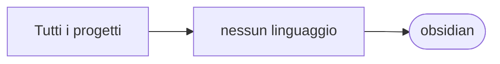

# obsidian

[Tutti i progetti](../README.md)

> Voce di catalogo generata dai metadati di GitHub con `build_projects.py` (`just projects`). Non si modifica a mano.

| | |
|---|---|
| Repository | [pakkio/obsidian](https://github.com/pakkio/obsidian) |
| Linguaggio | — |
| Tipo | originale |
| Creato | 2026-10-17 |
| Ultimo push | 2026-10-18 |
| Dimensione | 383 KB |

## Dal suo README

> obsidian Obsidian vault documenting all projects of github.com/pakkio. Projects.md` – map of content, one linked note per repository Concepts/` – cross-cutting topics (Python, MCP, RAG, OpenSim, ...)

## Dove si colloca

