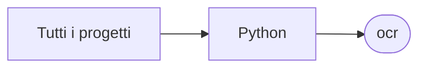

# ocr

[Tutti i progetti](../README.md)

> Voce di catalogo generata dai metadati di GitHub con `build_projects.py` (`just projects`). Non si modifica a mano.

| | |
|---|---|
| Repository | [pakkio/ocr](https://github.com/pakkio/ocr) |
| Linguaggio | Python |
| Tipo | originale |
| Creato | 2025-06-23 |
| Ultimo push | 2025-06-24 |
| Dimensione | 883 KB |

## Dal suo README

> 🚀 Advanced OCR Benchmark Suite A comprehensive comparison system for traditional OCR vs modern Vision Language Models (VLMs), featuring structured JSON extraction from complex dashboard images. 🎯 Overview This project demonstrates how modern Vision Language Models significantly outperform traditional OCR systems for complex structured data extraction. It provides a complete testing framework comparing 13 VLM models…

## Dove si colloca

