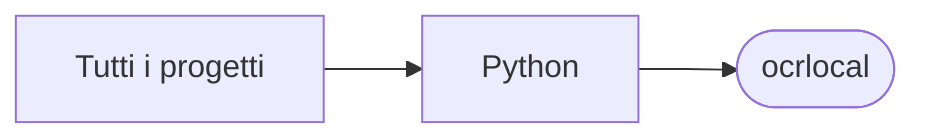

# ocrlocal

[Tutti i progetti](../README.md)

> Voce di catalogo generata dai metadati di GitHub con `build_projects.py` (`just projects`). Non si modifica a mano.

| | |
|---|---|
| Repository | [pakkio/ocrlocal](https://github.com/pakkio/ocrlocal) |
| Linguaggio | Python |
| Tipo | originale |
| Creato | 2026-05-03 |
| Ultimo push | 2026-10-18 |
| Dimensione | 299 KB |

## Dal suo README

> marker Pipeline locale PDF → Markdown con descrizione automatica delle figure via LLM vision. Stack:** Marker + Surya OCR + GPU (CUDA) + OpenRouter per vision. Funzionalità

## Dove si colloca

