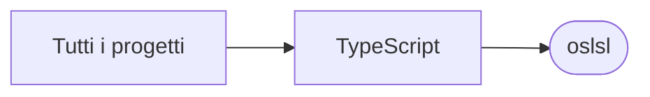

# oslsl

[Tutti i progetti](../README.md)

> Voce di catalogo generata dai metadati di GitHub con `build_projects.py` (`just projects`). Non si modifica a mano.

| | |
|---|---|
| Repository | [pakkio/oslsl](https://github.com/pakkio/oslsl) |
| Linguaggio | TypeScript |
| Tipo | originale |
| Creato | 2025-07-05 |
| Ultimo push | 2025-07-17 |
| Dimensione | 17369 KB |

## Dal suo README

> LSL MCP Server A specialized Model Context Protocol (MCP) server for LSL (Linden Scripting Language) and OpenSimulator development with advanced semantic analysis capabilities. 🚀 Enhanced Features Core Documentation Services

## Dove si colloca

