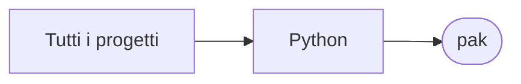

# pak

[Tutti i progetti](../README.md)

> Voce di catalogo generata dai metadati di GitHub con `build_projects.py` (`just projects`). Non si modifica a mano.

| | |
|---|---|
| Repository | [pakkio/pak](https://github.com/pakkio/pak) |
| Linguaggio | Python |
| Tipo | originale |
| Creato | 2025-04-18 |
| Ultimo push | 2025-08-07 |
| Licenza | MIT |
| Dimensione | 12952 KB |

pak, impacchetta un intero folder per analizzarlo con AI

## Dal suo README

> Pak: The Ultimate LLM Code Context Tool The Problem We All Face (But Rarely Admit) You're a developer in 2025. You use Claude, ChatGPT, or any other LLM for practically every development task. And every single time, it's the same **comedy of errors**: You need to share 5-10 files with the LLM for proper context

## Dove si colloca

