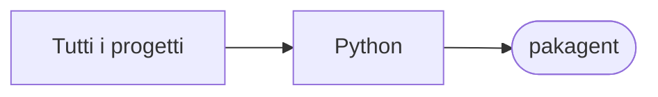

# pakagent

[Tutti i progetti](../README.md)

> Voce di catalogo generata dai metadati di GitHub con `build_projects.py` (`just projects`). Non si modifica a mano.

| | |
|---|---|
| Repository | [pakkio/pakagent](https://github.com/pakkio/pakagent) |
| Linguaggio | Python |
| Tipo | originale |
| Creato | 2025-06-21 |
| Ultimo push | 2025-06-22 |
| Licenza | MIT |
| Dimensione | 186 KB |

## Dal suo README

> PakAgent A secure, enterprise-grade 5-program workflow system for LLM-assisted code development using pak tool and pakdiff format. Overview PakAgent simplifies the process of getting LLM help with your code by automating the tedious copy-paste workflow. It uses the pak tool for semantic compression and pakdiff format for precise code changes.

## Dove si colloca

