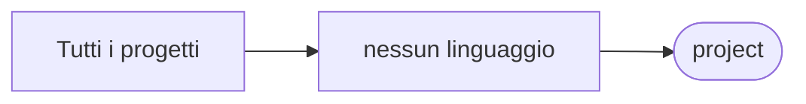

# project

[Tutti i progetti](../README.md)

> Voce di catalogo generata dai metadati di GitHub con `build_projects.py` (`just projects`). Non si modifica a mano.

| | |
|---|---|
| Repository | [pakkio/project](https://github.com/pakkio/project) |
| Linguaggio | — |
| Tipo | originale |
| Creato | 2016-02-18 |
| Ultimo push | 2026-10-18 |
| Dimensione | 1 KB |

## Dal suo README

> project Placeholder repository with a single test file. Nothing to run.

## Dove si colloca

