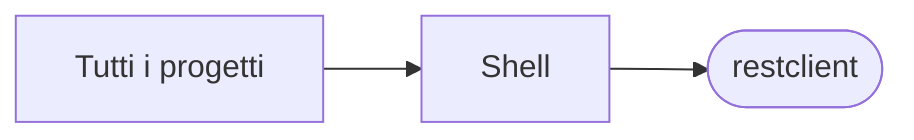

# restclient

[Tutti i progetti](../README.md)

> Voce di catalogo generata dai metadati di GitHub con `build_projects.py` (`just projects`). Non si modifica a mano.

| | |
|---|---|
| Repository | [pakkio/restclient](https://github.com/pakkio/restclient) |
| Linguaggio | Shell |
| Tipo | originale |
| Creato | 2017-12-30 |
| Ultimo push | 2017-12-31 |
| Dimensione | 54 KB |

## Dal suo README

> restclient Simplest client possible with RestTemplate and Spring Boot

## Dove si colloca

