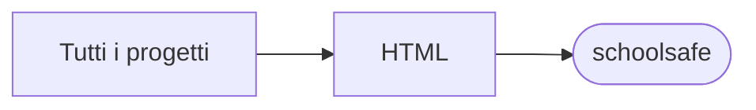

# schoolsafe

[Tutti i progetti](../README.md)

> Voce di catalogo generata dai metadati di GitHub con `build_projects.py` (`just projects`). Non si modifica a mano.

| | |
|---|---|
| Repository | [pakkio/schoolsafe](https://github.com/pakkio/schoolsafe) |
| Linguaggio | HTML |
| Tipo | originale |
| Creato | 2026-04-12 |
| Ultimo push | 2026-10-18 |
| Dimensione | 19 KB |

## Dal suo README

> SchoolSafe Single-page HTML app: a school evacuation simulation ("SchoolSafe — Simulazione Evacuazione Scolastica"). No build step: open `index.html` in a browser.

## Dove si colloca

