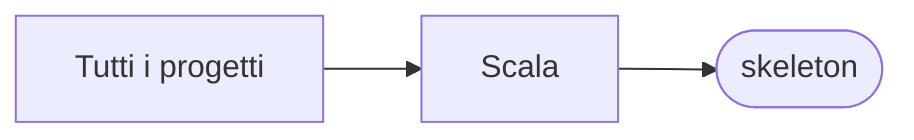

# skeleton

[Tutti i progetti](../README.md)

> Voce di catalogo generata dai metadati di GitHub con `build_projects.py` (`just projects`). Non si modifica a mano.

| | |
|---|---|
| Repository | [pakkio/skeleton](https://github.com/pakkio/skeleton) |
| Linguaggio | Scala |
| Tipo | fork |
| Creato | 2016-04-05 |
| Ultimo push | 2016-09-24 |
| Dimensione | 48 KB |

Simple Scala project template

## Dal suo README

> Skeleton This project aims to simplify creating a project from scratch, ready to use in your IDE. It's arguably simpler than typesafe activator or g8 because it doesn't require any additional tools, just clone, build and run. It provides a simple way to have a project running with the following tools configured:

## Dove si colloca

