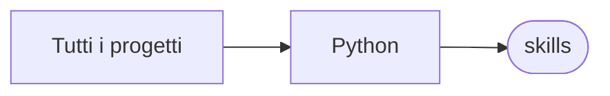

# skills

[Tutti i progetti](../README.md)

> Voce di catalogo generata dai metadati di GitHub con `build_projects.py` (`just projects`). Non si modifica a mano.

| | |
|---|---|
| Repository | [pakkio/skills](https://github.com/pakkio/skills) |
| Linguaggio | Python |
| Tipo | originale |
| Creato | 2026-08-02 |
| Ultimo push | 2026-08-02 |
| Dimensione | 12 KB |

## Dal suo README

> skills Agent skills for Claude Code / Freebuff-style agents. verbosity-control (trigger: `/terse`) Stops reasoning models from over-explaining. Applies **explicit output contracts** — not polite requests — in order of impact:

## Dove si colloca

