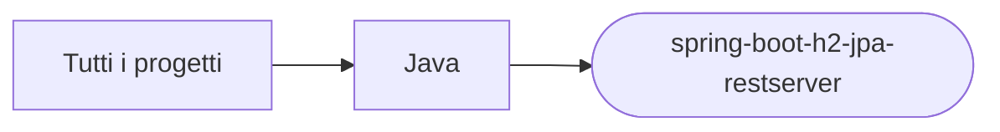

# spring-boot-h2-jpa-restserver

[Tutti i progetti](../README.md)

> Voce di catalogo generata dai metadati di GitHub con `build_projects.py` (`just projects`). Non si modifica a mano.

| | |
|---|---|
| Repository | [pakkio/spring-boot-h2-jpa-restserver](https://github.com/pakkio/spring-boot-h2-jpa-restserver) |
| Linguaggio | Java |
| Tipo | originale |
| Creato | 2018-01-01 |
| Ultimo push | 2026-10-18 |
| Dimensione | 17 KB |

## Dal suo README

> spring-boot-h2-jpa-restserver Minimal Spring Boot REST server backed by H2 via Spring Data JPA: an `Articolo` entity, `ArticoloRepository`, a REST `Controller` and `ApplicationStarter`. Config in `application.properties`.

## Dove si colloca

