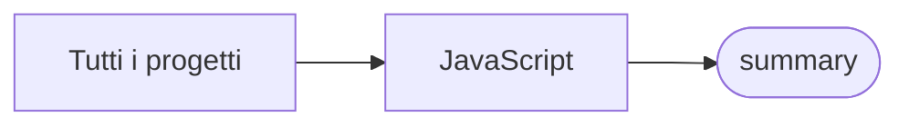

# summary

[Tutti i progetti](../README.md)

> Voce di catalogo generata dai metadati di GitHub con `build_projects.py` (`just projects`). Non si modifica a mano.

| | |
|---|---|
| Repository | [pakkio/summary](https://github.com/pakkio/summary) |
| Linguaggio | JavaScript |
| Tipo | originale |
| Creato | 2024-05-25 |
| Ultimo push | 2024-07-03 |
| Dimensione | 153 KB |

## Dal suo README

> LMStudio Summarizer LMStudio Summarizer è un'estensione per Chrome progettata per riassumere il contenuto delle pagine web utilizzando l'API di LMStudio. Funzionalità Riassunto delle Pagine Web**: Riassume il contenuto della pagina web attiva.

## Dove si colloca

