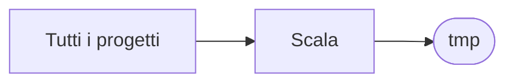

# tmp

[Tutti i progetti](../README.md)

> Voce di catalogo generata dai metadati di GitHub con `build_projects.py` (`just projects`). Non si modifica a mano.

| | |
|---|---|
| Repository | [pakkio/tmp](https://github.com/pakkio/tmp) |
| Linguaggio | Scala |
| Tipo | originale |
| Creato | 2017-09-06 |
| Ultimo push | 2017-09-07 |
| Dimensione | 4 KB |

## Dal suo README

> reamde

## Dove si colloca

