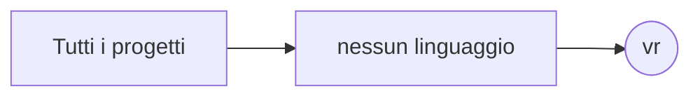

# vr

[Tutti i progetti](../README.md)

> Voce di catalogo generata dai metadati di GitHub con `build_projects.py` (`just projects`). Non si modifica a mano.

| | |
|---|---|
| Repository | [pakkio/vr](https://github.com/pakkio/vr) |
| Linguaggio | — |
| Tipo | originale |
| Creato | 2017-09-03 |
| Ultimo push | 2026-10-18 |
| Dimensione | 0 KB |

## Dal suo README

> Empty placeholder repository for virtual reality experiments (2017). See craftstorm for current virtual-world work.

## Dove si colloca

