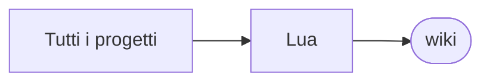

# wiki

[Tutti i progetti](../README.md)

> Voce di catalogo generata dai metadati di GitHub con `build_projects.py` (`just projects`). Non si modifica a mano.

| | |
|---|---|
| Repository | [pakkio/wiki](https://github.com/pakkio/wiki) |
| Linguaggio | Lua |
| Tipo | fork |
| Creato | 2017-12-13 |
| Ultimo push | 2017-03-13 |
| Licenza | Unlicense |
| Dimensione | 81 KB |

In-game Wiki for Minetest

## Dal suo README

> Wiki Mod Another random mod by me. This mod provides a "Wiki" block. You can create and edit wiki pages with it. The pages are saved as `/wiki/`. All spaces in the page

## Dove si colloca

